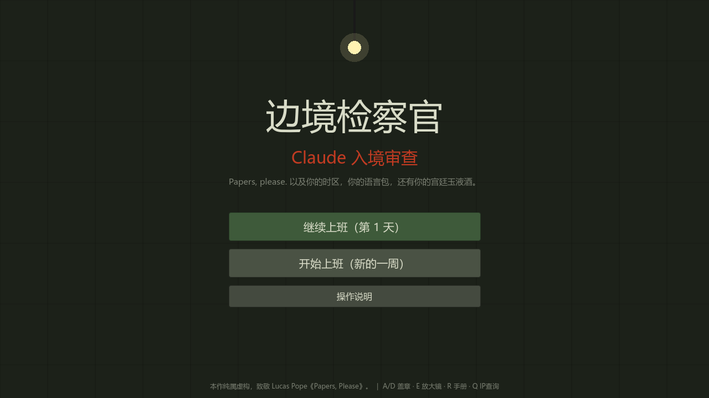
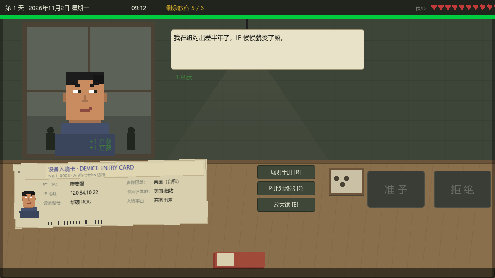
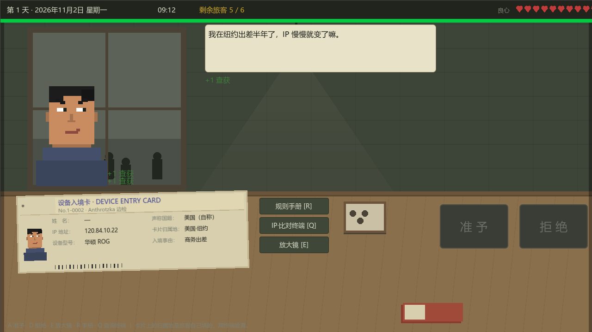

# 边境检察官：Claude 入境审查

[](https://github.com/havanaback/claude-border-inspection/releases/latest)
[](https://github.com/havanaback/claude-border-inspection/releases)
[](https://godotengine.org)
[](LICENSE)

> **Papers, please. 以及你的时区，你的语言包，还有你的宫廷玉液酒。**

一款致敬《Papers, Please》的黑色幽默模拟游戏。你是 **Anthrotzka** 边境检查站的检察官，每天坐在检查台后，审查一位又一位想"入境"使用 Claude 的旅客。核证件、比 IP、查时区、对暗号——规则手册一天比一天厚，而你手里的"准予/拒绝"两个章，决定着一个又一个人今天能不能用上 AI。



## ⬇ 下载（Windows x64，免安装）

### [**点此下载最新版**](https://github.com/havanaback/claude-border-inspection/releases/latest)

1. 在 Release 页面下载 `Claude-Border-Inspection-win64.zip`
2. **解压到任意文件夹**（`exe` 与 `pck` 必须在同一目录，不要只把 exe 拖出来单独运行）
3. 双击 `ClaudeBorderInspection.exe`，打开即玩，无需安装

> 首次运行若弹出 SmartScreen 蓝色提示，点「更多信息 → 仍要运行」。程序未做代码签名，这是开源小游戏的通病，并非有毒。
>
> exe 需要 Vulkan 支持（Forward+ 渲染）。极老的集显机器可能无法启动，可在 Godot 中改用 Compatibility 渲染器重导出。

## 运行方式（从源码）

**方式一**：安装 [Godot 4.7+](https://godotengine.org/download)，用 Godot 打开本项目（`project.godot`），按 `F5` 运行。

**方式二（命令行）**：

```bash
godot --path <本项目路径>
```

纯 2D 游戏，Forward+ 渲染（Vulkan），无需任何插件与外部素材。

## 玩法

每位旅客递上一张**设备入境卡**：IP 归属地、系统时区、系统语言、输入法、支付方式、卡 BIN 段、API 地址、雇主、所属组织……字段逐日增多。卡片上的"归属地"是旅客自己填的，真假要用 IP 查询终端验证；贴纸、涂改、伪造域名要用放大镜看；限时审查，慢了排队的人会抗议。



**八个工作日，规则逐日加码：**

| 天数 | 新规则 | 核心玩法 | 讽刺点 |
|---|---|---|---|
| 第 1 天 | 地区白名单 | 核对 IP | 机械盖章，查获率飙升 |
| 第 2 天 | 时区/语言一致性 | 三字段比对 | 真·美籍华人灰色地带 |
| 第 3 天 | 突击测谎 | 暗号小游戏 + 微表情 | "宁可错抓，不可漏放" |
| 第 4 天 | 支付一致性 | BIN 段核对 + 贴纸识别 | 美国 Visa 卡背面贴银联 |
| 第 5 天 | API 地址检查 | 域名逐字比对 | `anthopic` 少一个字母 |
| 第 6 天 | 股权穿透 | 持股链计算 | 解释权归合规部 |
| 第 7 天 | 连坐规则 | 组织名册红点 | 110 人连坐，无处申诉 |
| 第 8 天 | 规则矛盾日 | 没有正确答案 | 规则让你永远"可能违规" |
| 最终日 | **你被审查** | 测自己的暗号 | 没有人是安全的 |

**特色系统：**

- **良心值** —— 拒绝"无辜但违反规则"的旅客会扣良心（连坐受害者、答出暗号的留学生、中文系统的美籍华人……）。归零时，最终日你只剩一个选择。
- **申诉箱** —— 被拒旅客的申诉信（打字机逐字显示）。翻阅不会改变任何结果，这才是重点。
- **替代方案图鉴** —— 每拒绝一位旅客解锁一条国产大模型条目（Qwen / DeepSeek / 豆包 / Kimi / GLM），集齐解锁成就"感谢 Claude 老铁送来的用户"。
- **绩效与全家福** —— 查获率决定工资，工资决定今晚桌上有肉还是只有面包。



**两个结局**（此处不剧透）：顺从，或者摘下工牌。最终日的设备入境卡上，印着**你自己**的名字、时区和语言。

### 更多玩法（v1.1）

- **加班无尽模式（Beta）** —— 通关不是终点。八天规则全部叠加，每夜随机追加一条荒诞新规（"IP 末位为奇数者拒绝""姓名含「伟/强/军/明」者拒绝""戴眼镜者拒绝——影响人脸比对"……），旅客随机生成、违规随机组合。漏放 3 人即进绩效听证会，看你能坚持多少夜。
- **回头客** —— 你判过的人会回来。第 2 天被你拒绝的陈守仁，第 5 天带着全套英文系统再次出现；第 7 天连坐被拒的实习生小林，第 8 天不再递卡——他来给你送一杯蜜雪冰城。
- **成就系统** —— 15 项成就：初次查获、铁腕检察官、手起刀落、暗号猎人、良心泯灭、问心无愧、哲学家……以及集齐图鉴的"感谢 Claude 老铁送来的用户"。
- **站内广播** —— 检查台顶部的滚动新闻：「合规部否认规则存在矛盾。同时提醒：规则存在矛盾不影响执行。」

### 交互玩法（v1.2）

- **审问系统（W）** —— 主动向旅客提问（每位限问两次）。问"为什么时区是上海？"——心虚的人回答时瞳孔放大、冒冷汗，全记在你的审问笔记上。
- **照片比对（P）** —— 部分旅客的照片与档案库不符。进入找茬小游戏，在档案照上点出两处不同（眼镜/胡须/发型），坐实伪造。
- **暗号自选** —— 第 3 天军官把暗号本拍在桌上："你问。"从三句里挑一句——通用问题问不出东西，文化暗号答得出的就带走。选错问题，伪装者就从你手里溜走。
- **小费抉择** —— 被抓的真违规者会塞过来一张八百块的购物卡。收下（+8 克朗，但他就成了你的"漏放"，还可能被上级抽查）；上交（+3 克朗）；或严词拒绝。钱和绩效，选一个。

## 操作

| 键位 | 功能 |
|---|---|
| 鼠标 | 全部操作 |
| `A` / `D` | 准予 / 拒绝 |
| `X` | 拘留（突击测谎时） |
| `E` | 放大镜（悬停可疑字段取证） |
| `R` / `Q` | 规则手册 / IP·比对终端 |
| `G` / `F` | 股权查询 / 组织名册（第 6/7 天解锁） |
| `F11` | 全屏切换 |
| `Esc` | 关闭弹窗 |

## 素材与技术

**零外部素材**：所有画面元素（旅客像素头像、表情与微表情动画、检查台背景、印章、全家福）均由 GDScript 代码绘制；所有音效（盖章、心跳、皮鞋声、打字机、排队抗议、日光灯嗡鸣）在启动时用正弦波/噪声**实时合成 WAV**。整个游戏是纯 GDScript，UI 全部由代码构建，欢迎拆包检查。

```
scripts/
├── game.gd            # 全局状态（天数/良心/工资/图鉴/申诉信/存档）
├── sfx.gd             # 程序化音效合成器
├── main.gd            # 场景路由 + 加载画面
├── booth.gd           # 检查台主玩法（计时/判罚/暗号测谎）
├── card.gd            # 设备入境卡（放大镜取证/盖章印记）
├── portrait.gd        # 像素头像绘制（表情系统）
├── overlays.gd        # 手册/IP终端/股权穿透/组织名册弹窗
├── summary.gd         # 日结算 + 申诉箱 + 图鉴
├── final_day.gd       # 最终日
├── ending.gd          # 双结局
└── data_rules.gd / data_travelers.gd   # 8 天全部规则与旅客剧本
```

内置自动测试钩子：`godot --headless --path . -- --auto-test` 可让游戏自动玩通全部 8 天 + 最终日 + 结局，用于回归验证。

## 致敬与声明

本作纯属虚构，向 Lucas Pope 的《Papers, Please》(2013) 致敬。Anthrotzka 不存在于任何地图上。

游戏中的"规则"均为对真实事件的黑色幽默改编：2025 年 1 月，Anthropic 向部分中国用户发送"立即封禁"邮件，约 145 万账号受影响，约 1700 人提交申诉；地区白名单、时区/语言一致性核验、支付方式审查、组织连坐封禁等设定，均取材于用户社区的真实遭遇。

**规则不是为了让人遵守，而是为了让你永远处于可能违规的状态。**

## License

[MIT](LICENSE)
